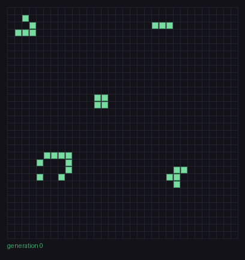

# Pipelined RV32I Processor with an Asynchronous Display Subsystem

A 5-stage pipelined RISC-V (RV32I) core written in Verilog, extended into a small SoC: a memory-mapped display subsystem on its own, unrelated clock, connected through an asynchronous FIFO. The demo program runs Conway's Game of Life on the core and streams every generation to the display.



*Each frame above was computed by the CPU, pushed through the async FIFO across clock domains, and captured from the display side of the simulation.*

---

## Highlights

- **5-stage in-order pipeline:** IF, ID, EX, MEM, WB, with full operand forwarding, load-use stalling and branch flushing.
- **Memory-mapped I/O:** one address (`0x400`) acts as both a write-only data port and a read-only status register.
- **Clock-domain crossing:** the CPU and display run on independent clocks. Data crosses through a dual-clock FIFO with Gray-coded pointers and two-flop synchronizers.
- **End-to-end demo:** Game of Life in RV32I assembly, with a seed you draw in a text file and an animated GIF made from the simulation output.

---


### Pipeline

| Stage | What happens |
|---|---|
| **IF** | PC → instruction memory |
| **ID** | Register read, immediate generation, load-use hazard detection |
| **EX** | ALU, branch resolution, PC redirect; operands forwarded from MEM and WB |
| **MEM** | Data memory access, store-data forwarding, MMIO decode |
| **WB** | Write-back mux (ALU / load data / PC+4) |

**Hazard handling**
- **Data hazards:** a forwarding unit selects each ALU operand from the register file, the MEM stage, or the WB stage.
- **Load-use:** a one-cycle stall when an instruction needs the result of the load directly ahead of it.
- **Control:** branches and jumps resolve in EX; younger instructions are flushed on a taken branch.
- **Store data:** a separate store-forwarding path (including a one-cycle `WB_copy` register) supplies the correct value to a store whose data register was written one or two instructions earlier.
  This path fixes a bug in an earlier version, where a store whose data register was written **two** instructions before it stored a stale value: by the time the store reached MEM, the producing instruction had already left WB, so neither the MEM nor the WB forwarding path could supply it.

**Memories:** 1 KiB instruction memory and 1 KiB data memory, byte-addressable (four byte lanes), with byte, half-word and word loads and stores and sign or zero extension. The PC is 10 bits.

**ISA coverage:** RV32I integer instructions, except `fence`, `ecall` and `ebreak`. No CSRs, interrupts or exceptions.

### Display subsystem


| Module | Role |
|---|---|
| `async_fifo` | Top of the FIFO: memory, two pointer handlers, two synchronizers |
| `ram` | Simple dual-port RAM, write port on the CPU clock, read port on the display clock |
| `ptr_handler` | Binary pointer for addressing, registered Gray copy for crossing, full/empty from the synchronized pointer |
| `two_flop` | Two-flop synchronizer for the Gray-coded pointers |
| `disp_ctrl` | Pops whenever the FIFO isn't empty; a one-cycle valid bit lines up with the RAM's registered read; a row counter places each word |
| `display_model` | 32 × 32 frame the testbench prints |
| `display_sub_sys` | Wraps the three above |

**CDC design choices**
- Only the **pointers** cross clock domains, as Gray code, so a synchronizer sampling mid-change sees either the old or the new pointer, never a mix.
- Each Gray pointer comes **straight from a flip-flop**, never from combinational logic, so it can't glitch while being sampled.
- **Full** is computed in the write domain and **empty** in the read domain, each from the other side's synchronized pointer. The synchronized pointer is always slightly stale, which only makes the flags pessimistic: the CPU may wait a cycle longer than necessary, but never overwrites unread data, and the display never reads a slot that hasn't been written.
- Data words never cross while changing: a word is written in one cycle and read only after the synchronized pointer says it's there, by which time it has been stable for several cycles.

### Memory map

| Address | Read (`lw`) | Write (`sw`) |
|---|---|---|
| `0x000 – 0x3FF` | Data memory | Data memory |
| `0x400` | `{31'b0, full}`: FIFO full flag | Push one 32-bit row into the FIFO |

The MMIO address is `BYTE_DEPTH`, decoded in the MEM-stage control unit. Data memory writes are gated to addresses below `BYTE_DEPTH`, so a push never also lands in data memory.

---

## Verification

Directed simulation in Vivado. The testbench (`dptb.v`) loads `program.mem` into instruction memory and `data.mem` into data memory, resets both clock domains, and prints each completed display frame to the console. The printed generations were compared against a separate software implementation of Life.

---

## Running the Game of Life demo

1. Put `program.mem` (hex, the assembled `life.s`) and `data.mem` (binary seed) in the simulation directory.
2. Draw a starting pattern in `data.mem`: 32 lines of 32 characters, `1` = alive. The leftmost character is the leftmost column, and the board wraps at all four edges.
3. Set `N_GEN` at the top of `dptb.v` and run the behavioral simulation.
4. Each frame is printed as:
   ```
   ---- gen 3 ----
   ..#.............................
   ...#............................
   .###............................
   ```
5. Make a GIF from the simulation log:
   ```
   pip install pillow
   python log2gif.py simulate.log life.gif --cell 12 --ms 150 --theme dark
   ```
   Vivado writes the log to `<project>.sim/sim_1/behav/xsim/simulate.log`.

**How the program works:** two 32-word grids in data memory are used as ping-pong buffers. For each row, the program loads the rows above, at and below it (wrapping), builds the eight neighbour planes with rotate-shifts, and counts neighbours for all 32 cells at once with bitwise adders. Each new row is stored into the other grid and pushed to `0x400` after polling the full flag. The seed itself is pushed first as generation 0.

---

## Current limitations

- No exceptions, interrupts or CSRs; `fence`, `ecall` and `ebreak` are not implemented.
- A store to `0x400` while the FIFO is full is dropped, so software must check the full flag before each push.
- Loads and stores to unmapped addresses aren't trapped: stores are ignored, and loads return aliased data-memory contents.
- A load from the status address uses the normal load-use stall.
- The display is a simulation model, not a real VGA output.
- Frame boundaries are implied by count: the program must push exactly 32 rows per frame.

## Possible next steps

- Rework the EX stage so store forwarding no longer needs the `WB_copy` register, and measure the change in switching activity.
- Refactor the MEM stage into a table-driven address decoder so new peripherals are one-line additions.
- Make the byte-addressable RAM procedural so the synthesis tool can infer block RAM.
- Add a start-of-frame bit to the FIFO, and eventually a real VGA scan-out.

---

## References

- C. E. Cummings, *Simulation and Synthesis Techniques for Asynchronous FIFO Design*, SNUG San Jose 2002.
- *The RISC-V Instruction Set Manual, Volume I: Unprivileged ISA.*
